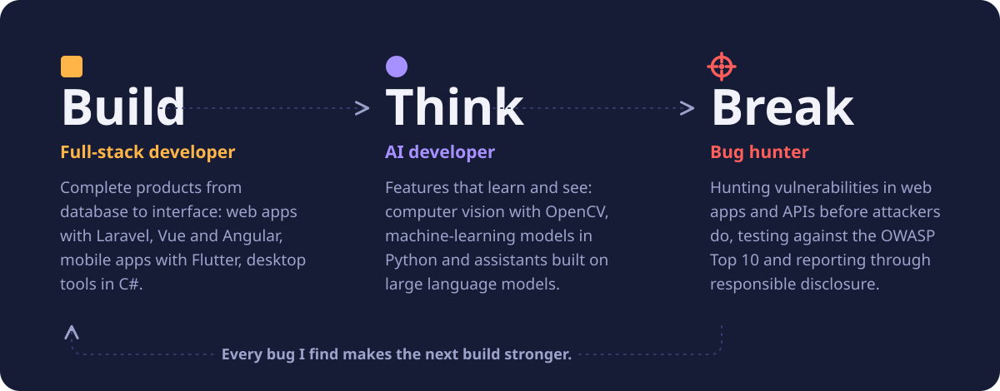

&nbsp;
&nbsp;
&nbsp;

## About me

I'm Twana, a developer who builds complete products and then looks at them the way an attacker would. I work across the whole stack, from databases and APIs to web, mobile and desktop interfaces, and I add AI where it makes a product genuinely smarter. As a bug hunter, I test web apps and APIs for vulnerabilities and report what I find responsibly.

I also teach programming in Kurdish through short videos on **twanst.codes**.

I'm energetic, ambitious and well organised, I keep my deadlines, and I do some of my best work under pressure.

## How I work

## Toolkit

## On GitHub

 

## Support my work

If my videos or code have helped you, a coffee helps me make the next one.

 

twanst.codes
 

